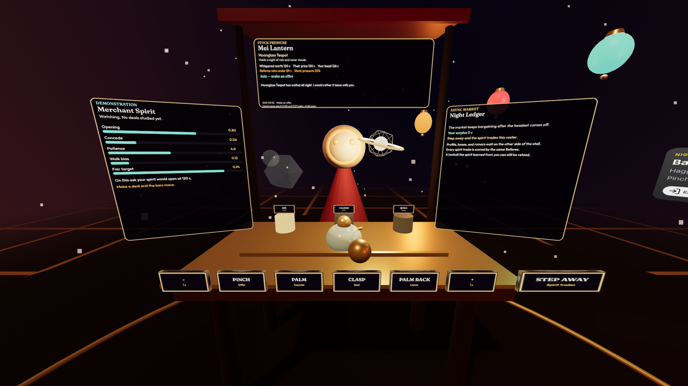
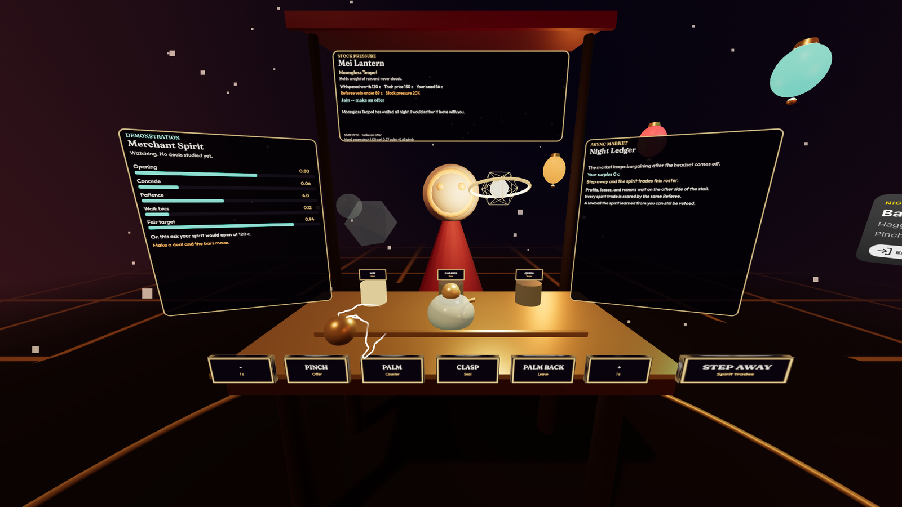
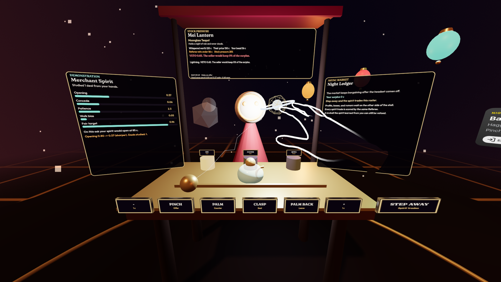
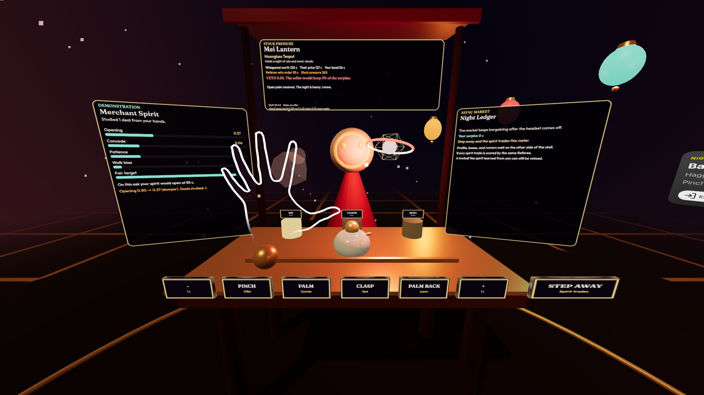
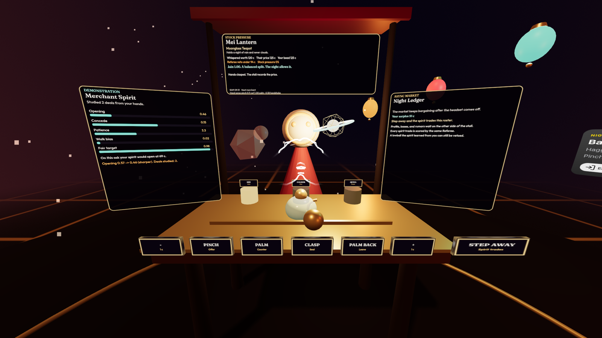
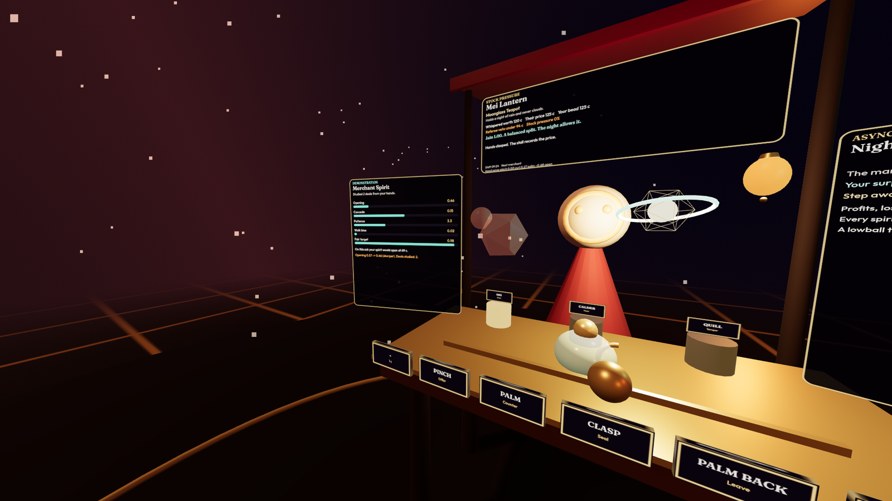
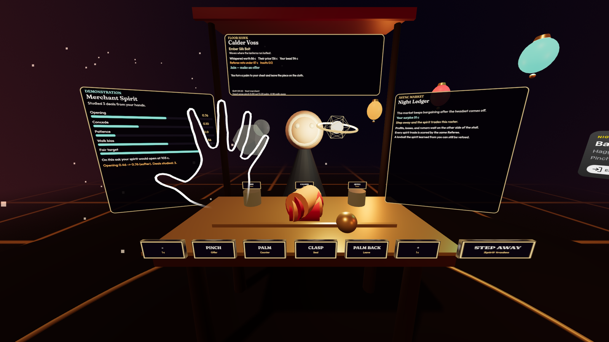
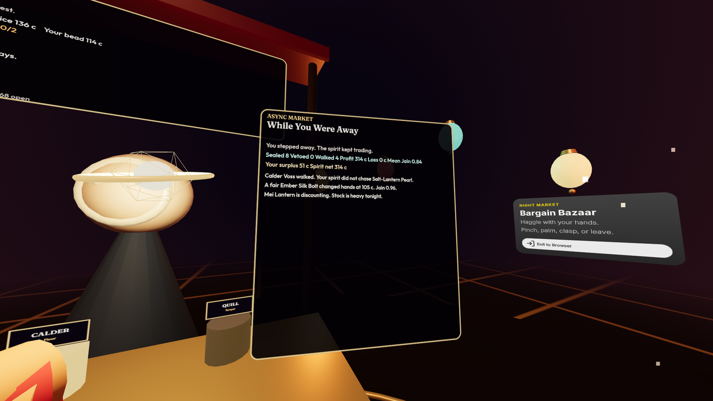

# Bargain Bazaar



**Haggle with your hands. Your style becomes an agent.**

Bargain Bazaar is a seated, controller-free WebXR night market. You haggle with
three merchants using only hand gestures. Every deal you make trains a Merchant
Spirit that copies your style, and when you take the headset off, that Spirit
keeps trading for you. A fairness referee watches every price, yours and the
Spirit's, and strikes exploitative lowballs with lightning.

- **Play in the browser:** <https://aarongrace978.github.io/bargain-bazaar/>
  (runs in the built-in XR simulator, so no headset, APK, or store invite is
  needed; on a Quest it opens straight into hand tracking)
- **Demo capture:** [`docs/demo/demo-capture.mp4`](docs/demo/demo-capture.mp4)
- **Entry:** Meta VR Start Developer Competition 2026

## See it in action

| | |
| --- | --- |
|  |  |
| **Pinch** the brass bead and slide it to set your price, then pinch in the air to offer. | **Lightning veto.** A lowball that leaves the seller almost nothing is struck down, and the referee shows its Jain score. |
|  |  |
| **Open palm** toward the merchant asks her to come down. | **Clasp** both fists together to seal at the agreed price. |
|  |  |
| **The Spirit learns.** Its opening, concession, patience, and walk-away bars move after every deal. | **Palm back** walks away from Calder Voss, the Floor Hawk. |



**While You Were Away.** The Spirit trades agent-vs-agent overnight and reports
deals sealed, vetoed, and walked, profit and losses, the mean Jain score, and
rumors from the row.

Full-resolution 1920x1080 screenshots are in [`public/screenshots/`](public/screenshots).

## The loop

Each shift is ten minutes at the stall, in four beats.

1. **Approach.** Take a seat at a merchant's stall. Each merchant has a plaque,
   a piece for sale, an asking price, and a tell.
2. **Inspect.** Pinch the offer bead on the cloth and slide it. The dialogue
   panel shows the whispered worth, the asking price, your bead, and the
   referee's veto line for this piece.
3. **Haggle.** Offer, counter, and seal with gestures. The merchant answers in
   character, and the referee scores every offer and every sealed deal.
4. **Sleep.** Press *Step Away* (or take the headset off). Your Merchant Spirit
   runs the stall against the other merchants while you are gone, and the
   *While You Were Away* report is waiting when you return.

### Gestures

| Gesture | How | Effect |
| --- | --- | --- |
| **PINCH** | Thumb and index together. On the bead: drag to set a price. In the air: offer it. | Makes an offer at the bead's price. |
| **PALM** | Open hand raised above the cloth, palm toward the merchant. | Asks the merchant to concede. |
| **CLASP** | Both fists brought together over the table, like a handshake. | Seals the deal. |
| **PALM BACK** | Open hand raised, palm turned toward your own chest. | Walks away from the deal. |

Palm gestures only count with the hand raised above the cloth, and each must be
held briefly, so a hand resting in your lap never counters or storms off by
accident. Every gesture also has a pressable plaque on the table edge, and on
desktop the keyboard works: `F` offer, `C` palm, `H` clasp, `X` walk away,
`M` step away, arrow keys move the bead, and `1` `2` `3` pick a merchant.

### Three merchants, three strategies

| Merchant | Strategy | Tell |
| --- | --- | --- |
| **Mei Lantern** | Stock Pressure | Her hidden floor falls the longer a piece sits unsold. A palm moves her. |
| **Calder Voss** | Floor Hawk | A high floor and tiny concessions. Two insults and he leaves. |
| **Quill Vesper** | Walk-away Temper | A dramatic cut, then a freeze. Push once more and she is gone. |

## The Merchant Spirit (demonstration learning)

The Spirit is behavioral cloning by exponential moving average
(`alpha = 0.55`), so one deal is enough to visibly move its bars. From every
deal it copies:

- your **opening ratio** (first offer divided by the asking price),
- your **concession size** per round,
- your **patience** (rounds before you seal or leave),
- your **walk-away bias**, and
- a **fairness target**, which a referee veto raises.

Lowball Mei and the Spirit learns to lowball. Haggle fairly and it learns to
open near fair value. The panel to your left shows the bars and the price the
Spirit would open at for the piece in front of you.

## While You Were Away (async agent economy)

When you step away, close the shift, or simply take the headset off, the
Spirit trades one deal per minute against the three merchants' strategies,
seeded and deterministic. When you come back (up to 90 minutes are simulated,
persisted in `localStorage`), the *While You Were Away* panel shows:

- deals sealed, vetoed, and walked,
- profit, losses, and the Spirit's net,
- the mean Jain score of everything it traded, and
- rumors from the row ("Mei Lantern is discounting. Stock is heavy tonight.").

Merchants change overnight, too: stock pressure builds and tempers remember.

## The fairness referee

The orb above the table scores every deal, the player's and the Spirit's, with
**Jain's fairness index** over the two parties' surplus:

$$J = \frac{\left(\sum u_i\right)^2}{n \cdot \sum u_i^2}$$

Each party's share of the bargaining zone (buyer value minus the seller's
hidden floor) maps into a utility band of `[15, 100]`, so a starved party is
not encoded as a hard zero. An even split scores `J = 1.0`.

If the seller would keep less than **18%** of the surplus (about `J < 0.82`),
the offer is an **exploitative lowball**: the referee vetoes it with
lightning, the deal cannot be sealed at that price, and the veto is recorded
for the Spirit to learn from. The same rule applies to the Spirit overnight,
so a Spirit trained on lowballs comes back with a report full of vetoes.

The index form and the `[15, 100]` clamp follow
[skyline-consensus](https://github.com/AaronGrace978/skyline-consensus), used as
a reference for the math only. Bargain Bazaar reimplements it for a two-party
price split.

## Quick start

```sh
pnpm install
pnpm dev
```

`pnpm dev` starts the IWSDK dev runtime and opens a managed browser with the
IWER XR simulator. Press **Enter XR**, then switch the simulator's input to
hands. `npm install` and `npm run dev` work too.

```sh
pnpm test        # game logic: fairness, gestures, merchants, spirit, market
pnpm typecheck
pnpm build       # static build in dist/, with the XR simulator injected
```

Pushing to `main` builds and deploys `dist/` to GitHub Pages.

## Tech stack

- [IWSDK](https://iwsdk.dev) (Immersive Web SDK) with its ECS world, ray
  interactables, scene JSON, and the IWER XR emulator injected into the
  production build
- WebXR with hand tracking (`local-floor`, seated), from wrist, metacarpal,
  and pinch joint data
- TypeScript, Vite, and Three.js, with canvas-drawn panels and procedural
  meshes, so there are no downloaded models
- `node --test` unit tests for all game logic

```text
src/game/      pure game logic: session, merchants, spirit, market, fairness, gestures
src/xr/        hand-joint reader (pinch, curl, palm normal)
src/render/    stall meshes, canvas panels, layout, audio
src/systems/   the IWSDK system that wires input, game, and rendering
test/          unit tests
```

## License

[MIT](LICENSE), Copyright (c) 2026 Aaron Grace.
